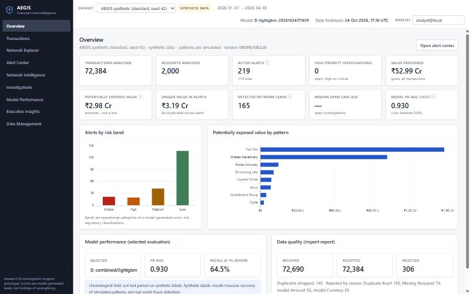
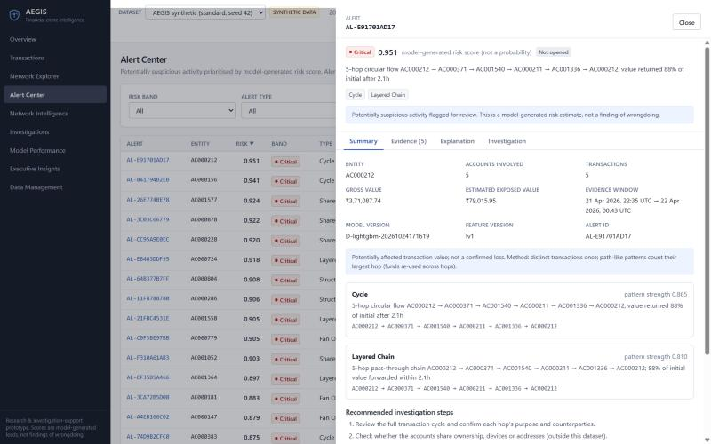
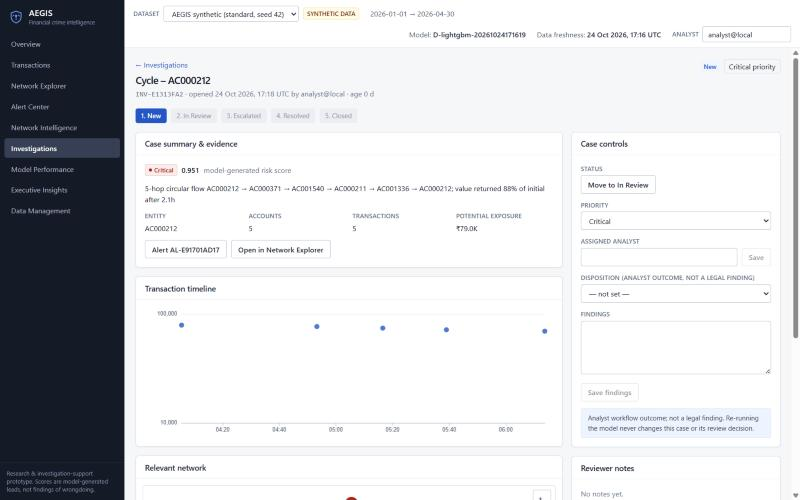
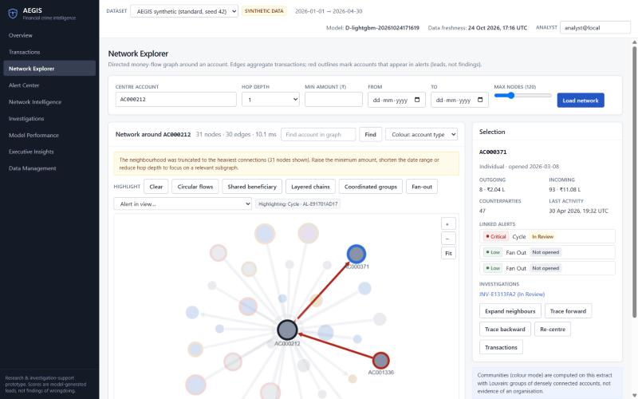

# AEGIS — Advanced Engine for Graph Intelligence and Suspicious Financial Activity Detection

A full-stack **financial-crime analytics and investigation-support prototype**. It combines transaction-level anomaly scoring, account behaviour analysis and **graph analytics** (temporal cycles, pass-through chains, shared beneficiaries, coordinated groups, communities) into evidence-backed, prioritised alerts that an analyst can investigate in a case workflow.

> **Responsible-use notice.** AEGIS is a research / portfolio prototype, **not** a certified AML system. Alerts are *investigative leads* ("potentially suspicious activity", "model-generated risk score", "investigation priority") — never findings of wrongdoing. **All data and all reported results are synthetic**; they measure recovery of *simulated* patterns and must not be presented as real-world detections or savings.



## What problem does it solve?

Rule-based monitoring looks at payments one at a time. Many laundering-style behaviours are only visible in the *relationships and timing between* payments: value hopping through accounts within hours, funds returning to their origin, many unrelated accounts converging on one payee, groups paying the same uncommon counterparties together. AEGIS detects these structures *and* scores each against the entity's own history and a benign baseline (payroll, marketplaces, group bills, aggregators — all simulated as look-alikes), then ranks leads with explanations, exposure estimates and recommended steps.

## Features

| Area | What is implemented (and tested) |
|---|---|
| Data | Deterministic synthetic generator (10 scenario families incl. mandatory benign look-alikes, hidden labels, injected data defects); CSV import with schema inspection, mapping, validation, dedupe, quality report and downloadable error file |
| Graph engine | Time-aware weighted digraph with transaction lineage; bounded subgraph extraction; temporal cycle & pass-through-chain detection; baseline-aware fan-in/out & shared-beneficiary; coordination vs a time-shifted null; Louvain communities with flow stats; forward/backward approximate fund-flow tracing; node metrics (PageRank, reciprocity, clustering, sampled betweenness) |
| Behaviour | Point-in-time windowed features (1h–30d), robust z-scores, dormancy, bursts, structuring-like repeats; incremental implementation verified equal to a brute-force oracle |
| ML | Rules baseline, logistic regression, random forest, LightGBM, IsolationForest; four feature groups; chronological split with scenario purging; held-out template evaluation; bootstrap CIs; capacity metrics; cost-based thresholds with disclosed assumptions; calibration check; SHAP |
| Risk | Noisy-OR over signal families, alert de-duplication, exposure that does not double-count path hops, versioned and reproducible |
| Cases | Alert → investigation, state machine, priority/assignee, notes, linked alerts, attached transactions, disposition, full audit trail; re-runs never overwrite human review |
| UI | Overview, Transaction Explorer, Network Explorer (Cytoscape), Alert Center, Network Intelligence, Investigations workspace, Model Performance (+ monitoring/drift, business-impact), Executive Insights (deterministic), Data Management |
| Ops | FastAPI + OpenAPI, Alembic migration, Dockerfiles/compose (not built here), health checks, structured logging, PSI drift, streaming simulator, benchmark script |

## Quick start

Prerequisites: Python ≥ 3.10 (developed on 3.12), Node ≥ 18 (developed on 24). Docker is optional (see below).

**Windows (PowerShell)**
```powershell
git clone <this repo> aegis; cd aegis
.\scripts\setup.ps1                       # installs backend (editable) + frontend deps, creates .env
.\scripts\demo.ps1                        # generate synthetic data -> ingest -> train -> analyse  (~2.5 min; add --quick for ~40 s)
cd backend; uvicorn app.main:app --port 8000      # API + docs at http://localhost:8000/docs
# second terminal
cd frontend; npm run dev                  # UI at http://localhost:5173  (proxy target: VITE_API_TARGET, default http://127.0.0.1:8000)
```

**macOS / Linux**
```bash
./scripts/setup.sh && ./scripts/demo.sh   # same steps (add --quick for the small dataset)
cd backend && uvicorn app.main:app --port 8000 &
cd ../frontend && npm run dev
```

`demo` is `python -m app.cli all`, i.e. `init-db → seed → train → pipeline`. Individual commands:

```bash
cd backend
python -m app.cli generate --out ../data/synthetic   # CSVs + hidden ground truth (reproducible, --seed N)
python -m app.cli seed [--quick]                     # ingest through the same validation path as uploads
python -m app.cli train                              # chronological training + evaluation, stores a ModelRun
python -m app.cli pipeline                           # features → scoring → detectors → risk → alerts
python -m app.report                                 # regenerate docs/evaluation_report.md and docs/model_card.md from stored results
python -m alembic -c ../alembic.ini upgrade head     # alternative to create_all: apply the migration (set AEGIS_DATABASE_URL)
```

You can also generate data, train, and run the pipeline from the UI (**Data Management**). Configuration is via environment variables (`.env.example`); SQLite is the default, PostgreSQL via `AEGIS_DATABASE_URL`.

**Docker (provided, not verified in the authoring environment):** `docker compose up --build` → UI on http://localhost:8080, API on :8000. Then seed with `docker compose exec backend python -m app.cli all`.

## Verification

```bash
cd backend && python -m pytest -q            # backend: data, features, graph, ML, risk, investigations, API, streaming
cd backend && python -m ruff check app tests
cd frontend && npm run typecheck && npm test && npm run build
python benchmarks/scripts/run_benchmarks.py --sizes 10000 100000 500000
```

See [`docs/evaluation_report.md`](docs/evaluation_report.md) for measured model results, [`benchmarks/results/benchmark_results.md`](benchmarks/results/benchmark_results.md) for measured runtimes (hardware recorded), and [`docs/limitations.md`](docs/limitations.md) for what is *not* verified.

## Key measured results (synthetic benchmark, test period 30 Apr 2026 window; details and caveats in the reports)

| Question | Result |
|---|---|
| Does behaviour/graph context help? (LightGBM, test PR-AUC; prevalence 1.5%) | transaction-only **0.44** → +behaviour **0.74** → +graph **0.88** → all **0.93** (95% CI 0.91–0.95); rules baseline **0.10** |
| Held-out scenario templates | combined 0.86 vs transaction-only 0.36 |
| Top-1% review capacity | precision 98.9%, recall 64.5% of simulated-suspicious transactions |
| Business-impact (cases, ~19 simulated suspicious scenarios) | AEGIS combined risk covers all 19 within the top 25 alerts (88% case precision) vs 37% for simple rules at 100 cases and 63% for transaction-only ML at 25 cases. **Caveat:** an alert bundles a whole pattern, so those 25 alerts contain 326 transactions to read vs ~66 for transaction-level cases; costs are assumptions (₹250/case) and no savings are claimed |
| Evasion stress test (slower hops, value leakage) | model PR-AUC 0.93 → 0.91; rules ≈ 0.03 |
| Calibration | Scores are not treated as probabilities (explained in the UI and docs) |

These show the pipeline works on simulated structure; they do **not** estimate real-world performance.

## Measured performance (single run, 12-thread Ryzen 5 4600H laptop, 15 GB RAM, SQLite; `benchmarks/results/benchmark_results.md`)

| Stage | 10k txns | 100k txns | 518k txns (500k target) |
|---|---|---|---|
| Import (validate + dedupe + DB write) | 3.9 s | 42 s | 247 s |
| Point-in-time feature generation | 1.2 s | 13.6 s | 74 s |
| Graph construction | 0.9 s | 9.8 s | 49 s |
| Graph features (degree, PageRank, clustering) / Louvain | 0.15 / 0.11 s | 3.3 / 2.8 s | 22 / 17 s |
| All detectors over the full period | 1.3 s | 11 s | 38 s |
| 2-hop subgraph query p50 / p95 | 27 / 42 ms | 26 / 48 ms | 31 / 50 ms |
| LightGBM training (200 trees) | 0.6 s | 2.1 s | 7.7 s |
| Single-row prediction p50 | 1.7 ms | 1.8 ms | 2.1 ms |
| Peak RSS | 259 MB | 683 MB | 1.8 GB |

The slowest stages are the SQLite import and the single-threaded Python feature sweep. Reported numbers are measurements, not guarantees.

## Repository layout

```
backend/app/        synthetic/ ingestion/ db/ features/ graph/ ml/ risk/ investigations/ monitoring/ streaming/ services/ api/
backend/tests/      data · features · graph · ml · risk · investigations · api · streaming
frontend/src/       pages/ components/ hooks/ layouts/ services/ types/ utils/ test/
migrations/         Alembic (initial schema)
benchmarks/         scripts/ + results/ (measured)
docs/               architecture · data_dictionary · api_documentation · model_card · evaluation_report · security · limitations · demo_walkthrough · screenshots
docker/ scripts/ .env.example docker-compose.yml
```

## Documentation index

* [Architecture, decisions, ideation ranking](docs/architecture.md)
* [Data dictionary & generator](docs/data_dictionary.md) · [API](docs/api_documentation.md)
* [Model card](docs/model_card.md) · [Evaluation & business-impact report](docs/evaluation_report.md)
* [Security & responsible use](docs/security.md) · [Limitations & roadmap](docs/limitations.md)
* [Demo walkthrough, interview talk track, resume bullets](docs/demo_walkthrough.md)

## Screenshots

| Alert detail | Investigation workspace | Network explorer |
|---|---|---|
|  |  |  |

(Screenshots are of the running application, captured at reduced resolution.)

## Honest status

Verified here: backend and frontend tests, lint, type-check, production build, end-to-end alert → investigation flow in a browser, benchmarks on SQLite. **Not verified here:** Docker builds/compose, PostgreSQL, Neo4j/Kafka (intentionally not implemented), any real or public dataset (PaySim was not used).
