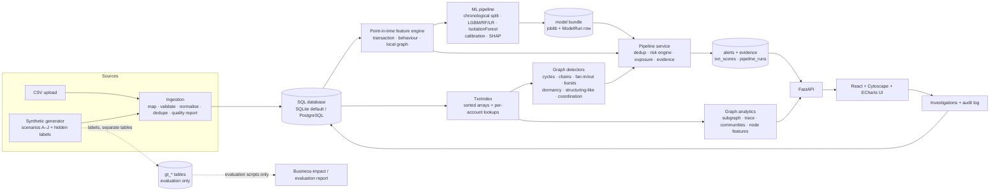

# AEGIS architecture and design decisions

AEGIS is a **research and investigation-support prototype**. It surfaces *potentially suspicious* patterns and *model-generated risk scores* for analyst review. It is not a certified AML system and makes no legal determinations.

## 1. System overview

**Layers** (`backend/app/`): `synthetic/` (generator) · `ingestion/` (CSV → canonical schema) · `db/` (SQLAlchemy models) · `features/` (as-of feature engine) · `graph/` (index, builder, analytics, detectors) · `ml/` (training, evaluation, bundle) · `risk/` (scoring, exposure) · `services/` (pipeline, business impact, jobs) · `investigations/` (case workflow) · `monitoring/` (drift) · `streaming/` (simulator) · `api/` (REST routes). Top-level: `frontend/`, `migrations/` (Alembic), `benchmarks/`, `docs/`, `scripts/`, `docker/`.

Deviation from the suggested layout: `ml/` and `synthetic_data/` live inside `backend/app/` as packages (one installable Python distribution, no cross-package path hacks).

## 2. Technology decisions

Format: *problem → options → choice → why → trade-offs → how evaluated.*

| # | Decision | Rationale and trade-off | Evaluation |
|---|---|---|---|
| D1 | **SQLite default, PostgreSQL by URL** | Zero-setup reproducibility. ORM (SQLAlchemy 2) + Alembic migration generated from the same models. Trade-off: SQLite has one writer; PostgreSQL support is by construction but **not tested in this repository's CI** (no Postgres instance was available). | Benchmarks record SQLite write times. |
| D2 | **NetworkX over a `TxnIndex`, no Neo4j** | The analytics need temporal, amount-aware traversal over transaction rows; a static property graph loses that. A numpy-array index with per-account time-sorted row lookups makes bounded temporal DFS cheap, and `GraphSource` (graph/index.py) is the seam where a graph DB could be plugged in. Neo4j was **not** implemented. | Query latency and detector times in `benchmarks/results/`. |
| D3 | **Temporal DFS for cycles/chains instead of static `simple_cycles`** | Static enumeration explodes on dense graphs and ignores time/value. Our DFS only follows hops that occur *later* within a window and keep plausible value; bounded by branching cap, result cap and a time budget. Trade-off: heuristics (value-retention band) can miss cycles that leak more value. | Unit tests incl. dense-graph termination; detector recall on simulated patterns. |
| D4 | **Point-in-time features via one chronological sweep** | Guarantees no look-ahead; O(n) amortised with sliding-window counters. The *same* `FeatureState` serves batch, streaming and tests. A brute-force oracle verifies equality. | `test_features.py` (equality + leakage). |
| D5 | **LightGBM + RF + LR, chosen on validation PR-AUC** | Imbalanced tabular data; compare, don't assume. No GNN: the local graph features capture the structures simulated here, and GNN training adds complexity without a demonstrated need on this data. | Feature-group × algorithm grid in the evaluation report. |
| D6 | **Noisy-OR risk engine over signal families** | Correlated signals (model + anomaly) are collapsed by `max` inside a family; families combine with diminishing returns; missing families are skipped, not imputed. Weights are *operational*, not fitted. A rules-only and a model-only score are stored alongside for comparison. | Business-impact table (combined vs. pattern-only vs. model-only vs. rules). |
| D7 | **In-process streaming simulator, no Kafka** | Transport is not what is being evaluated; the incremental feature path is. Reusing `FeatureState` proves batch/stream parity. Throughput numbers are measured and labelled as single-process. A broker would add operational weight without analytic value here. | `test_streaming.py`, `/api/streaming/simulate`. |
| D8 | **Alerts are deterministic, labels are quarantined** | `alert_id = hash(dataset, type, entity, hour)`. Re-runs upsert; alerts under human review are updated in evidence but never in review state. Ground-truth tables are read only by training/evaluation modules (test enforces no references in graph/risk/features/api). | `test_investigations.py::test_rerunning_pipeline…`, `test_graph.py::test_inference_code_does_not_touch_ground_truth`. |
| D9 | **React + Cytoscape + ECharts (no UI kit)** | A small set of in-house components keeps the bundle and visual language restrained. Cytoscape handles interactive directed graphs; bounded server-side subgraph extraction avoids rendering thousands of nodes. | Vitest flow tests, manual browser verification. |

## 3. Graph feature inventory (cost and interpretation)

| Feature / analysis | Interpretation | Cost | Where |
|---|---|---|---|
| In/out degree, weighted degree, counterparties, reciprocity | Breadth and two-way relationships | O(m) | `graph/analytics.py::node_features` |
| PageRank | Value-weighted centrality | O(k·m), k≈50–100 | same (scipy) |
| Clustering coefficient | Local triangle density | O(Σdeg²) – capped by node count | same |
| Betweenness | Brokerage between groups | O(n·m) exact → sampled (k≤100), on demand only | same (`with_betweenness`) |
| Louvain communities | Densely connected groups – *not* criminal organisations | ~O(m log n) | `detect_communities`, cached per (dataset, window) |
| Fan-in / fan-out, shared-beneficiary | Unique counterparties within a window vs. the account's own 95th-percentile history | O(rows of candidate accounts) | `detectors.detect_fan` |
| Temporal cycles (3..max_len hops) | Funds returning within a window with plausible value retention | bounded DFS | `detect_cycles` |
| Pass-through chains | Each hop forwards most of a recent receipt | O(n·k) DP | `detect_chains` |
| Coordinated groups | Same *uncommon* counterparties at near-identical times, vs. a time-shifted null | pair counting | `detect_coordinated` |
| Point-in-time local features (`d_uniq_senders_24h`, `cycle_close2/3`, `chain_len`, …) | Used by the supervised model without look-ahead | O(1) amortised/txn | `features/engine.py` |

Global metrics (PageRank, communities) are **not** used as supervised features: computing them on the full graph would leak future edges; per-snapshot versions are a roadmap item.

## 4. Financial-exposure definitions

* **Gross transaction value** – Σ amount over distinct transactions in an alert.
* **Estimated exposed value** – distinct transactions once; for path-like patterns (cycle, chain) only the **largest hop**, because the same funds recur on every hop. A heuristic upper-bound on distinct funds.
* **Incremental unique value** – value of transactions not already claimed by a higher-ranked alert (cross-alert de-duplication).
* **Potentially affected value** – dashboard KPI = Σ per-alert exposed value. *Not* loss, not fraud prevented.
* **Confirmed loss** – not available; would have to be supplied independently.

## 5. Additional ideas: evaluation and decisions

Candidates were scored on: real analytics problem · differentiation · feasible with available data · objectively testable · improves investigation · explainable in an interview · value/complexity.

| Rank | Idea | Decision | Why |
|---|---|---|---|
| 1 | **Temporal-feasibility-aware cycle/chain detection** (time + value retention) | **Built (v1)** | Core differentiator over static graph queries; testable with hand-made graphs. |
| 2 | **Baseline-aware concentration** (compare fan-in/out with the entity's own history) and benign look-alike scenarios | **Built (v1)** | Directly addresses the main false-positive source (merchants, payroll, aggregators); unit-tested. |
| 3 | **Time-shifted null for coordination** (observed vs. chance co-occurrence) | **Built (v1)** | Prevents "common counterparty = coordination" error; reported as observed vs expected. |
| 4 | **Alert de-duplication + non-double-counted exposure** | **Built (v1)** | Mandatory for credible financial summaries; tested. |
| 5 | **Cost-sensitive thresholding and capacity-based evaluation** | **Built (v1)** | Maps ML output to analyst workload; assumptions disclosed. |
| 6 | **Adversarial evasion stress test** (generator `evasion_level`) | **Built (v1)** | Cheap with a generator; shows detector fragility honestly. |
| 7 | **Leave-templates-out evaluation** | **Built (v1)** | Addresses synthetic-template leakage. |
| 8 | **Incremental/streaming parity** | **Built (v1)** | Feature engine shared; equality tested. |
| 9 | Counterfactual explanations ("score without graph features") | Optional extension | SHAP already conveys drivers; counterfactual adds modest value. |
| 10 | Human-in-the-loop feedback → retraining; analyst-disagreement analysis | Optional extension | Needs real reviewer labels; audit trail already stores the raw material. |
| 11 | Snapshot graph embeddings / temporal motifs | Optional extension | Needs rolling snapshots to stay leak-free; evaluate vs. current local features first. |
| 12 | Investigation queue optimisation (expected value ÷ effort) | Optional extension | Natural next step after cost model validation. |
| 13 | Entity resolution / cross-dataset matching | Rejected for now | Needs identity attributes not in the data model; legal/privacy surface; unverifiable on synthetic data. |
| 14 | Graph neural networks | Rejected for now | No evidence they beat local features here; opaque; heavy dependency. |
| 15 | Privacy-preserving analytics (DP, federated) | Rejected for now | Out of scope for a single-tenant synthetic prototype. |
| 16 | External LLM summaries | Rejected for core | Insights are deterministic templates; an LLM could be added only with retrieval over stored evidence and explicit user consent. |

## 6. Scalability notes

Measured results (hardware and configuration recorded) are in `benchmarks/results/benchmark_results.md`. Known bottlenecks: the Python feature sweep is single-threaded; coordinated-group detection pair counting scales with the number of shared rare counterparties; SQLite insert speed dominates import. Practical fallbacks: restrict detectors to the analysis window, cap per-hop branching, and cache communities.
